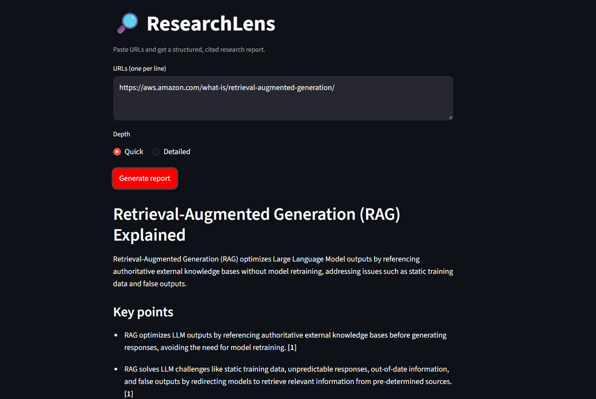

# 🔎 ResearchLens

Paste URLs, get a structured research report where every key point cites the source it came from.

**Live demo:** https://researchlenz.streamlit.app/
## Problem

Researching a topic means opening many tabs and skimming long pages. ResearchLens does the first pass and shows where each claim came from, so you can verify it.

## Features

- Fetches and cleans text from one or more URLs
- Splits long pages into chunks and summarizes them (map-reduce)
- Produces a structured report: title, summary, key points, open questions, sources
- Every key point carries source citations
- Output is validated with Pydantic; invalid JSON is sent back to the model for correction
- Streamlit UI with Quick and Detailed modes and a Markdown download

## How it works

URLs → fetch and clean → chunk (~6000 chars, with overlap) → summarize each chunk → combine into a JSON report → validate and retry → show in the UI

## Setup

    git clone https://github.com/fayazahamedofficial/research-assistant.git
    cd research-assistant
    python -m venv .venv
    .venv\Scripts\activate
    pip install -r requirements.txt

Create a `.env` file with a free Gemini API key from aistudio.google.com:

    GEMINI_API_KEY=your-key-here

Run:

    streamlit run app.py

## What I learned and what failed

- Web pages are full of menus and footnotes. Keeping only headings, paragraphs and list items, then removing footnote markers, fixed noisy text.
- Models sometimes return invalid JSON. Sending the Pydantic error back for a retry fixes most cases.
- Free API tiers limit requests per minute, so calls are throttled and retried with backoff.
- Prompt V1 let citation markers like [1] leak into the text; V2 forbids this.

## Limitations

- Quick and Detailed modes read only the first few chunks of each page.
- Tested mainly on Wikipedia pages. Paywalled or JavaScript-heavy sites may fail.
- Summaries can still contain mistakes; check the cited source.
- Uses the Gemini free tier, which has rate limits.

## Future work

Evaluation of prompt versions, web search for topic-only input, PDF upload, follow-up chat.